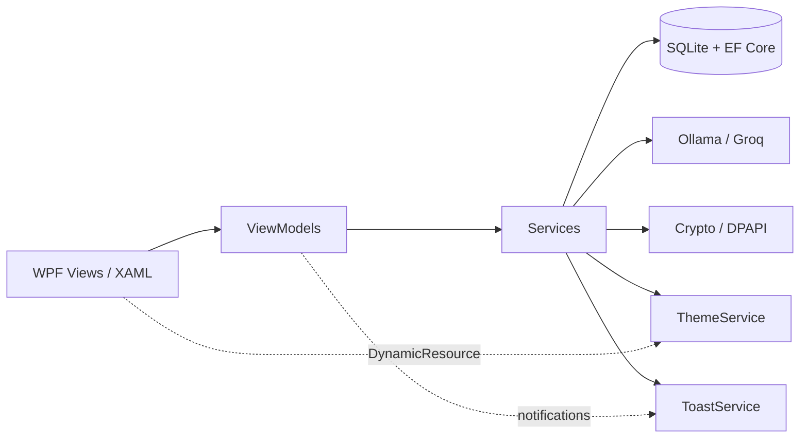

# DoItNow

**A local-first workspace for developers: tasks, code notes, an encrypted secrets vault
and on-device AI. Built with WPF and .NET 8.**

DoItNow puts the things a developer reaches for all day in one window: a daily planner, a
syntax-highlighted code notes editor, an AES-256-GCM vault for API keys and AWS
credentials, offline document conversion, and a hybrid AI assistant that can run entirely
on your machine. Local profiles, nine themes, SQLite persistence, no account required.

<p>
  
  
  
  
  
</p>

---

## Why DoItNow

Developers rarely lose time to a missing kanban board. They lose it to context switching:
the ticket lives in one app, the snippet in another, the API key in a `.env` file, the
spec in a PDF, and the assistant in a browser tab that ships your code to someone else's
server.

DoItNow collapses that loop into a single local-first desktop app:

- **Plan the day, not the backlog** — a real calendar, a tight agenda and quick filters
  instead of weeks of grooming.
- **Keep code notes where the code is** — syntax highlighting for eight languages and
  export to real source files.
- **Keep secrets out of `.env` files and chat logs** — an encrypted vault that imports AWS
  credentials and stores credential files as encrypted attachments.
- **Turn specs into tasks** — drop a PDF, Word or Markdown file and let the assistant
  extract actionable items, offline if you prefer.
- **Run AI on proprietary code** — local Ollama inference by default, Groq Cloud as an
  optional fallback.

It is also a complete desktop engineering showcase: MVVM, dependency-light services,
local SQLite persistence, a semantic theming system, and reproducible demo data for
screenshots.

---

## Built for developer workflows

| You are… | DoItNow gives you… |
| --- | --- |
| Planning a sprint day | Dashboard calendar, daily agenda and quick filters — no backlog grooming |
| Reading a spec or issue export | Document mode extracts tasks from PDF, Word, Markdown or plain text |
| Jotting a snippet | Code notes with highlighting for C#, JSON, SQL, JS, Python, PowerShell, XML and Markdown |
| Rotating credentials | Encrypted vault with AWS CSV/INI import and encrypted attachments |
| Working on proprietary code | Local Ollama inference — prompts and code never leave the machine |
| Sharing a PC | Local profiles with optional password and separate databases |

---

## Highlights

- **Encrypted key vault** — store API keys, tokens, connection strings and passwords
  protected with AES-256-GCM. Optional master password (PBKDF2-SHA256) or transparent
  protection via Windows DPAPI; secrets stay masked until you reveal them.
- **Code notes with real highlighting** — an AvalonEdit-powered editor with line
  numbers, syntax highlighting for C#, JSON, SQL, JavaScript, Python, PowerShell, XML
  and Markdown, clipboard-aware pasting and file export.
- **Hybrid AI workspace** — local [Ollama](https://ollama.com) inference with automatic
  fallback to [Groq Cloud](https://console.groq.com), in one place: a conversational
  assistant and a document mode that turns notes or text files into actionable tasks.
- **Offline document conversion** — convert PDF, Word, Excel, CSV, JSON, Markdown and
  plain text entirely on your machine. Batch queue, drag and drop, live preview and a
  configurable destination folder. No uploads, no accounts, no third-party services.
- **Local profiles with optional password** — a sign-in screen keeps separate workspaces
  on the same machine. Each profile owns its database, settings, chat history and vault;
  the password is stored only as a PBKDF2-SHA256 verifier. The first profile adopts any
  database created by older versions, with no manual migration.
- **Live dashboard** — greeting, real today/week dates, pending/completed metrics and
  an animated progress bar driven by the database.
- **Task management** — create, edit, complete, delete, search and filter by category
  and priority, with toast feedback and an inline creation form.
- **Calendar & agenda** — a fully working WPF `CalendarItem` template (`PART_MonthView`
  / `PART_YearView`) with per-day task filtering, integrated into the dashboard.
- **Portable encrypted backup** — export the vault to a password-protected
  `.ditvault` file and import it on another machine. No cloud account required.
- **Nine selectable themes** — Claro, Oscuro, Sepia, Medianoche, Océano, Nord, Rosé,
  Cinnamoroll and Alto contraste. Semantic brush tokens are swapped at runtime and persisted across
  sessions, with startup CLI override support.
- **Micro-interactions** — section transitions, hover-lift cards, animated toasts,
  a window entrance animation and a theme-aware startup veil that never delays loading.
- **Desktop details** — a multi-size app icon for the executable, window and taskbar;
  borderless chrome with custom window controls; window bounds restored on launch.
- **Session restore** — reopens the last visited module (including the AI Chat/Documents
  sub-mode) and restores the window size, position and maximized state on launch.
- **Local-first** — all data lives in a local SQLite database; no cloud account required.
- **Portfolio-ready demo mode** — one flag loads curated tasks and a sample AI
  conversation, so screenshots are always reproducible.

---

## Feature tour

### Profiles and sign-in

DoItNow opens on a local profile screen. Profiles are not cloud accounts: they are
workspaces stored on this machine, designed for shared computers and for keeping contexts
separate (personal, work, demos).

- Each profile has its own SQLite database, theme, settings, chat history and vault.
  Deleting a profile deletes its folder, including the encrypted vault key.
- Password protection is optional. When set, the app derives a PBKDF2-SHA256 verifier
  (210,000 iterations, per-profile salt) and never stores the password itself.
- The password locks the app UI. It does **not** encrypt the whole database (tasks, notes
  and chat remain readable on disk). Vault entries and attachments are separately
  encrypted, as described below.
- Creating the first profile moves a pre-existing `%LOCALAPPDATA%\DoItNow\doitnow.db`
  into that profile's folder, so an upgrade never loses data.
- The rail's sign-out button returns to the profile screen; the profile's window bounds
  and last section are saved before the session is closed.

### Code notes

A dedicated code editor replaces the Windows notepad for snippets and technical notes.
It keeps line numbers, highlights syntax per language, tracks unsaved changes, and
exports real source files with the right extension. Everything is stored locally, so it
works completely offline.

### Encrypted key vault

Store API keys, tokens, connection strings and passwords in an encrypted vault. Secrets
are never shown in plain text by default and are only decrypted in memory when the vault
is unlocked.

- **Transparent mode** — on first launch the vault is protected by a random key wrapped
  with Windows DPAPI (bound to the current Windows user). No password to remember.
- **Master password mode** — derive the key with PBKDF2-SHA256 and unlock every entry
  with a single password. Changing the password re-encrypts the whole vault.
- **Encrypted export/import** — move the vault between machines with a `.ditvault` file
  protected by its own password.
- **Encrypted attachments** — attach credential files, certificates or JSON keys to any
  entry. They are encrypted with the same AES-GCM key, capped at 10 MB per file and
  included in `.ditvault` backups.
- **AWS credentials import** — read an IAM access-key CSV export or an `~/.aws/credentials`
  (INI) file, create or update the matching entries, and keep the original file attached.

### Command center

The dashboard is the single planning hub: a real month calendar, the daily agenda, quick
filters, a plan board and the next pending tasks. The week strip is generated from the
selected date — no hardcoded labels — and clicking a day updates the agenda, the plan
board and the header instantly. There is no separate calendar module to duplicate this
work.

### Task management

Search, a compact category filter next to the search box, priority colors, inline
edit/delete, and a collapsible creation form. Cards stay minimal: the only category cue
is a small icon in the footer. Completing a task updates the dashboard metrics and raises
a toast in real time.

### AI workspace

One module with two modes, switched from a segmented control at the top:

- **Chat** — the assistant prefers a local Ollama model and falls back to Groq Cloud when
  the local server is unavailable. Responses are stored per conversation in SQLite.
- **Documents** — two tools in one place:
  - **Convert** — turn PDF, Word, Excel, CSV, JSON, Markdown and plain text into other
    formats without leaving your machine. Queue several files, drag and drop them,
    preview the result and choose the destination folder. Nothing is uploaded.
  - **Extract tasks** — load a text-like document, preview it, and ask the active AI
    provider to extract tasks or summarize its content.

### Settings

Configure the theme, AI provider, endpoints, models and API key (masked by default), open
the database folder, or load curated demo data.

### Themes

Nine palettes are available: Claro, Oscuro, Sepia, Medianoche, Océano, Nord, Rosé,
Cinnamoroll and Alto contraste. Switch them from the top bar or from **Settings → Apariencia**, where
every option shows a live color preview. The choice is applied instantly and persisted
without a restart.

---

## Tech stack

| Layer | Technology |
| --- | --- |
| Runtime | .NET 8 (`net8.0-windows`) |
| UI | WPF / XAML |
| Presentation | MVVM with `CommunityToolkit.Mvvm` |
| Persistence | SQLite + EF Core 9 |
| Editor | AvalonEdit (syntax highlighting, line numbers) |
| Security | AES-256-GCM + PBKDF2-SHA256, Windows DPAPI |
| Identity | Local profiles with optional PBKDF2 password verifier |
| AI | Ollama (local) + Groq Cloud (OpenAI-compatible API) |
| Icons | FontAwesome.WPF / FontAwesome.Sharp |
| Theming | Custom semantic resource dictionaries with runtime swap |
| Testing | xUnit, Microsoft.NET.Test.Sdk (CI on Windows) |

---

## Architecture



The app follows a classic MVVM split:

- **Views** (`MainWindow.xaml`, `Views/*.xaml`) contain layout and animation only.
- **ViewModels** orchestrate navigation, filtering, commands and state.
- **Services** own persistence (`TaskService`, `SettingsService`, `NoteService`),
  AI (`OllamaService`, `ChatService`), security (`CryptoService`, `VaultService`),
  profiles (`ProfileService`, `AppSession`) and
  cross-cutting concerns (`ThemeService`, `ToastService`, `SyntaxHighlightingService`).
- **Models** are plain data objects; EF Core maps them in `Data/AppDbContext.cs`.

### Project structure

```text
DoItNow/
├─ DoItNow/
│  ├─ App.xaml / App.xaml.cs        # Startup, session/login orchestration, error handling
│  ├─ MainWindow.xaml(.cs)          # Shell, navigation, toasts, window chrome
│  ├─ Views/                        # Login, Tasks, Notes, Vault, AI workspace, Settings
│  ├─ ViewModels/                   # Main + per-module view models
│  ├─ Models/                       # Task, SubTask, Chat, Settings, VaultEntry, VaultAttachment, CodeNote, AppProfile
│  ├─ Services/                     # Task, Notes, Vault, Crypto, AWS importer, Profiles, AI, Theme, Dialog, Toast
│  ├─ Controls/                     # CodeEditor (AvalonEdit host with theme-aware colors)
│  ├─ Converters/                   # Theme-aware value converters
│  ├─ Data/                         # EF Core DbContext + initialization
│  ├─ Assets/DoItNow.ico            # Multi-size app icon (exe, window, taskbar)
│  └─ Styles/
│     ├─ Themes/LightTheme.xaml     # Semantic palette: Claro
│     ├─ Themes/DarkTheme.xaml      # Semantic palette: Oscuro
│     ├─ Themes/SepiaTheme.xaml     # Semantic palette: Sepia
│     ├─ Themes/MidnightTheme.xaml  # Semantic palette: Medianoche
│     ├─ Themes/OceanTheme.xaml     # Semantic palette: Océano
│     ├─ Themes/NordTheme.xaml      # Semantic palette: Nord
│     ├─ Themes/RoseTheme.xaml      # Semantic palette: Rosé
│     ├─ Themes/CinnamorollTheme.xaml   # Semantic palette: Cinnamoroll
│     ├─ Themes/HighContrastTheme.xaml  # Semantic palette: Alto contraste
│     ├─ ButtonStyle.xaml           # Buttons, combo boxes, inputs
│     └─ CalendarStyles.xaml        # Custom WPF calendar template
├─ DoItNow.Tests/                   # xUnit suite: crypto, vault, profiles, AWS parser
├─ docs/screenshots/                # Selected portfolio screenshots
└─ DoItNow.sln
```

---

## Getting started

### Requirements

- Windows 10 or newer
- [.NET 8 SDK](https://dotnet.microsoft.com/download/dotnet/8.0)
- Optional: [Ollama](https://ollama.com) for fully local AI
- Optional: a free [Groq API key](https://console.groq.com) for cloud fallback

### Build & run

```powershell
git clone https://github.com/your-username/DoItNow.git
cd DoItNow
dotnet restore DoItNow/DoItNow.csproj
dotnet build DoItNow/DoItNow.csproj
dotnet run --project DoItNow/DoItNow.csproj
```

Or open `DoItNow.sln` in Visual Studio 2022 and press **F5**.

> Building the solution from the CLI is also supported, but add `-m:1`
> (`dotnet build DoItNow.sln -m:1`) to avoid a known WPF temporary-assembly race on
> cold builds.

### First run

1. The app opens on the profile screen. Create a profile (name and, optionally, a
   password of at least 8 characters) and press **Crear y entrar**.
2. Every profile stores its data in its own folder; the vault starts in transparent DPAPI
   mode until you set a vault master password.
3. To switch workspaces, use the sign-out button at the bottom of the left rail. The
   profile screen also lets you change or remove a profile password and delete a profile
   with its data.

If you are upgrading from a version without profiles, the existing
`%LOCALAPPDATA%\DoItNow\doitnow.db` is moved into the first profile you create.

### Tests

The suite covers cryptography, the encrypted vault (entries, attachments, master-password
rotation and encrypted export/import), the AWS credentials parser, and the local profile
registry (creation, password verification and rotation, deletion, legacy database
migration and registry recovery). Each test runs against a temporary SQLite database and a
temporary profile root, so your real data is never touched.

```powershell
dotnet test DoItNow.Tests/DoItNow.Tests.csproj
```

CI runs the same command on every push. Pushing a `v*` tag publishes a framework-dependent
Windows build on the Releases page.

### Configuration

Copy the example configuration and add your own values:

```powershell
Copy-Item DoItNow/appsettings.example.json DoItNow/appsettings.json
```

```json
{
  "AiSettings": {
    "Provider": "Auto",
    "OllamaEndpoint": "http://localhost:11434",
    "OllamaModel": "llama3.2",
    "GroqApiKey": "YOUR_GROQ_API_KEY"
  },
  "AppSettings": {
    "Theme": "dark"
  }
}
```

`Provider` accepts `Auto`, `Ollama` or `Groq`. In `Auto` mode the app uses Ollama when
it is reachable and falls back to Groq otherwise. `Theme` accepts a theme id from the
table in [Design system](#design-system); legacy values such as `Claro` and `Oscuro` are
still understood.

> **Security:** `appsettings.json` is git-ignored on purpose. Never commit real API
> keys. The Settings screen masks keys by default and only reveals them on demand.

### Vault security model

The key vault never writes secrets in plain text. Each entry is encrypted with
AES-256-GCM (random 96-bit nonce, 128-bit authentication tag, versioned Base64 blob)
before it reaches SQLite.

| Mode | How the encryption key is protected |
| --- | --- |
| **Windows (default)** | A random 256-bit key is wrapped with DPAPI under the current Windows user. Unlocks automatically on the same account. |
| **Master password** | Key derived with PBKDF2-SHA256 (210,000 iterations, per-vault salt). Only a verifier is stored, never the password or the key. |

Notes:

- The master password is **not recoverable**. Losing it means losing the entries.
- Changing the master password re-encrypts every entry with the new key.
- Removing the master password re-encrypts the vault again and returns to DPAPI mode.
- Attachments use the same key as entries: changing or removing the master password
  re-encrypts every stored file as well.
- `.ditvault` exports are encrypted with a separate password using the same primitives,
  so backups remain safe when moved through cloud storage or email. Format v2 adds
  attachments; v1 files still import.

### Profile password (app lock)

The profile password is a local access barrier, not disk encryption. The app verifies it
with PBKDF2-SHA256 and refuses to open the workspace without it, but tasks, notes and chat
messages remain in a plain SQLite database. The vault is the encrypted store: keep secrets
there. For full at-rest protection, enable BitLocker or an equivalent OS-level solution.

### Database

Each local profile keeps its own SQLite database:

```text
%LOCALAPPDATA%\DoItNow\profiles\<profile-id>\doitnow.db
```

The profile registry (`%LOCALAPPDATA%\DoItNow\profiles.json`) stores only display names,
ids and PBKDF2 password verifiers. Tasks, conversations, code notes and encrypted vault
entries (including their files) stay inside the profile's database.

Delete a profile from the sign-in screen to remove its folder; deleting the database also
deletes the wrapped vault key, so exported backups are the only way to recover entries
afterwards. If `profiles.json` is corrupted, the app rebuilds the list from the profile
folders so the data is not orphaned.

---

## Demo mode (CLI)

Useful for screenshots, demos and quick reviews. The app still opens the profile screen
unless `--profile` can sign in automatically; the other flags apply once a profile is open.

| Flag | Description |
| --- | --- |
| `--profile=<name>` | Signs in directly when that profile exists and has no password (ideal for demos). |
| `--demo` | Loads curated tasks and a sample AI conversation (idempotent). |
| `--theme=<id>` | Overrides the profile theme at startup (`light`, `dark`, `sepia`, `midnight`, `ocean`, `nord`, `rose`, `cinnamoroll`, `contrast`). |
| `--section=dashboard` | Opens the dashboard (calendar, agenda and plan board). |
| `--section=tasks` | Opens task management. |
| `--section=calendar` | Alias of `dashboard`; the calendar lives there. |
| `--section=notes` | Opens code notes. |
| `--section=vault` | Opens the encrypted key vault. |
| `--section=chat` | Opens the AI workspace in Chat mode. |
| `--section=doctools` | Opens the AI workspace in Documents mode. |
| `--section=settings` | Opens settings. |

Example:

```powershell
dotnet run --project DoItNow/DoItNow.csproj -- --profile=Demo --demo --theme=dark --section=dashboard
```

---

## Design system

The theme is not a filter or an overlay. Every view consumes semantic brushes such as
`SurfaceBrush`, `TextPrimaryBrush` or `AccentBrush` through `DynamicResource`.
`ThemeService` keeps a catalog of theme dictionaries and swaps them at runtime, so the
whole UI updates instantly without touching a single view.

| Id | Name | Mood |
| --- | --- | --- |
| `light` | Claro | Lavender daylight with the signature lime accent |
| `dark` | Oscuro | Deep lavender night with lime highlights |
| `sepia` | Sepia | Warm paper surfaces and amber accents |
| `midnight` | Medianoche | Deep navy with an electric blue accent |
| `ocean` | Océano | Dark teal with a fresh aqua accent |
| `nord` | Nord | Arctic slate with a frost-blue accent |
| `rose` | Rosé | Soft blush surfaces with a vivid rose accent |
| `cinnamoroll` | Cinnamoroll | Dreamy pastel blue, cloud whites and a sky-blue accent |
| `contrast` | Alto contraste | Pure black, white text and high-visibility yellow |

Themes can be switched from the top bar or from **Settings → Apariencia**, where each
option includes a live color preview. The selection is persisted automatically.

Every dictionary defines the same 55 semantic keys, grouped into:

- **Surfaces** — cards, inputs, hover states and borders
- **Text** — primary, secondary, muted and on-dark
- **Accents** — primary, accent and danger pairs
- **Calendar** — panel, selected, today and timeline colors
- **Task cards** — priority-specific background and foreground pairs

Adding a new theme means creating one dictionary with the same keys and registering its
`ThemeInfo` in the `ThemeService` catalog — no view changes required.

---

## Roadmap

- [x] Nine selectable themes with persistence and live previews
- [x] Real calendar template and date-driven dashboard
- [x] Toast notifications and section transitions
- [x] Demo data and reproducible screenshot flags
- [x] Encrypted key vault with optional master password
- [x] Code notes with syntax highlighting (AvalonEdit)
- [x] Encrypted vault export/import
- [x] Encrypted vault attachments and AWS credentials import
- [x] Local profiles with optional password and per-profile databases
- [x] Multi-size app icon and window/taskbar integration
- [ ] Drag-and-drop task scheduling on the timeline
- [ ] Recurring tasks and reminders
- [ ] Command palette (`Ctrl+K`) for navigation and quick capture
- [ ] Import `.env` files into the encrypted vault
- [ ] CSV / Markdown export of tasks and code notes
- [ ] Optional cloud sync backend
- [x] Build CI workflow
- [x] Automated test suite (xUnit) with CI test runs
- [x] Tagged GitHub releases with a packaged Windows build

---

## License

Released under the [MIT License](LICENSE).
