# DoItNow

**A calm, AI-assisted productivity desktop app built with WPF and .NET 8.**

DoItNow brings tasks, calendar, daily planning, a hybrid AI assistant, an encrypted key
vault and a real code editor into a single focused workspace. It ships with a
hand-crafted design system, a fully functional light/dark theme, meaningful animations,
and a local-first data model.

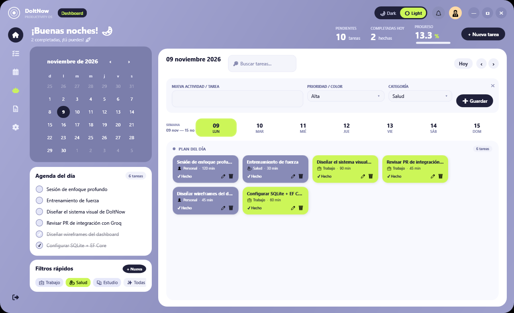

<p>
  
  
  
  
  
</p>

---

## Why DoItNow

Most task apps ask you to adapt to their workflow. DoItNow was built around a simple
idea: **plan the day, not the backlog**. The dashboard pairs a real calendar with a
tight daily agenda and a visual plan board, while the AI assistant helps break work
down without leaving the app.

It is also a complete desktop engineering showcase: MVVM, dependency-light services,
local SQLite persistence, a semantic theming system, and reproducible demo data for
screenshots.

---

## Highlights

- **Real light & dark themes** — semantic brush tokens swapped at runtime, persisted
  across sessions, with startup CLI override support.
- **Live dashboard** — greeting, real today/week dates, pending/completed metrics and
  an animated progress bar driven by the database.
- **Task management** — create, edit, complete, delete, search and filter by category
  and priority, with toast feedback and an inline creation form.
- **Calendar & agenda** — a fully working WPF `CalendarItem` template (`PART_MonthView`
  / `PART_YearView`) plus per-day task filtering.
- **Hybrid AI assistant** — local [Ollama](https://ollama.com) inference with automatic
  fallback to [Groq Cloud](https://console.groq.com) for low-latency replies.
- **Document intelligence** — load notes or text files and extract actionable tasks
  with the active AI provider.
- **Encrypted key vault** — store API keys, tokens and passwords protected with
  AES-256-GCM. Optional master password (PBKDF2-SHA256) or transparent protection via
  Windows DPAPI; secrets stay masked until you reveal them.
- **Code notes with real highlighting** — an AvalonEdit-powered editor with line
  numbers, syntax highlighting for C#, JSON, SQL, JavaScript, Python, PowerShell, XML
  and Markdown, clipboard-aware pasting and file export.
- **Portable encrypted backup** — export the vault to a password-protected
  `.ditvault` file and import it on another machine. No cloud account required.
- **Micro-interactions** — section transitions, hover-lift cards, animated toasts and
  a window entrance animation.
- **Local-first** — all data lives in a local SQLite database; no account required.
- **Portfolio-ready demo mode** — one flag loads curated tasks and a sample AI
  conversation, so screenshots are always reproducible.

---

## Feature tour

### Command center

A real calendar on the left, a daily agenda, quick filters, and a plan board on the
right. The week strip is generated from the selected date — no hardcoded labels —
and clicking a day filters the plan instantly.

| Light | Dark |
| --- | --- |
|  | 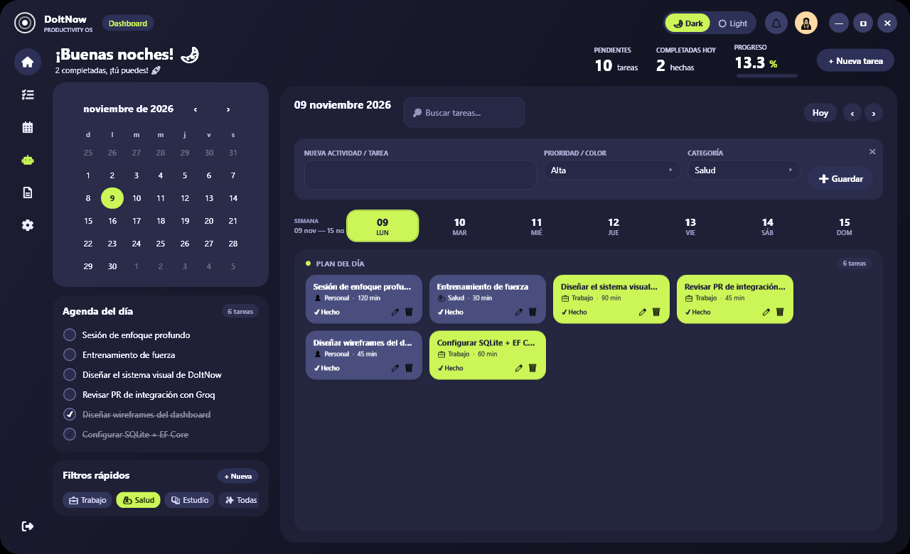 |

### Task management

Search, category pills, priority colors, inline edit/delete, and a collapsible creation
form. Completing a task updates the dashboard metrics and raises a toast in real time.

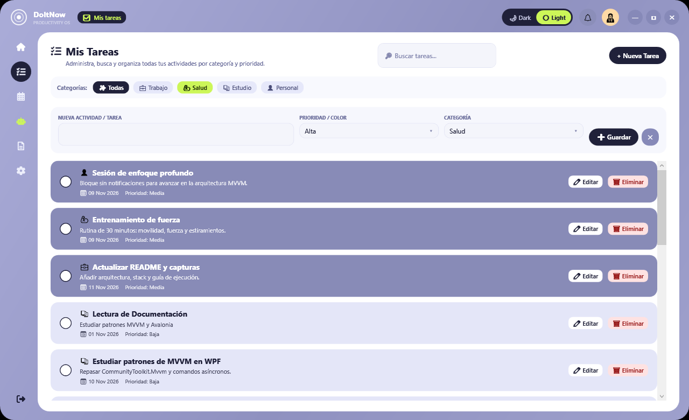

### Calendar & daily agenda

The calendar is a real WPF `Calendar` with a custom template, not a static image.
Selecting a date drives both the header label and the agenda panel.

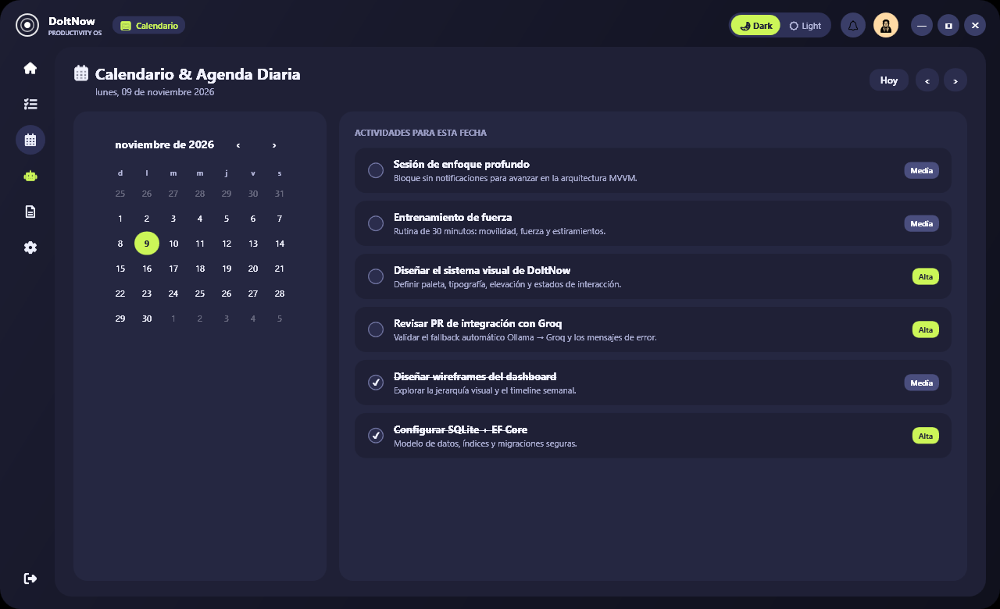

### AI assistant

The assistant prefers a local Ollama model and falls back to Groq Cloud when the local
server is unavailable. Responses are stored per conversation in SQLite.

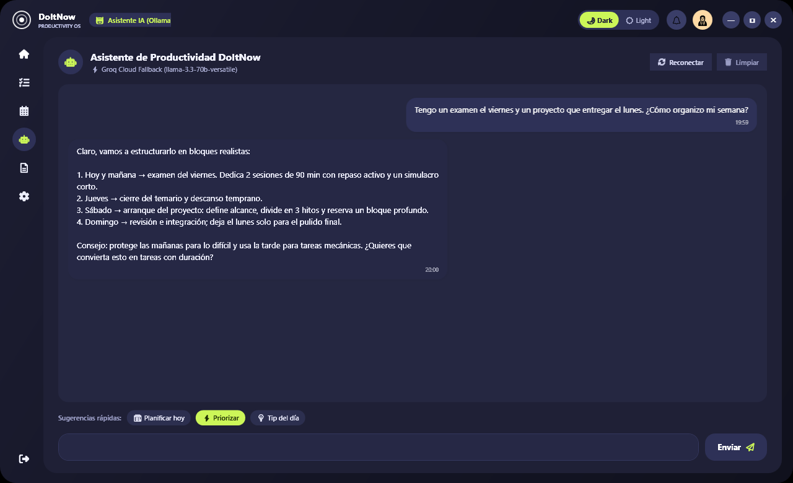

### Document tools

Load a text-like document, preview it, and ask the active AI provider to extract tasks
or summarize its content.

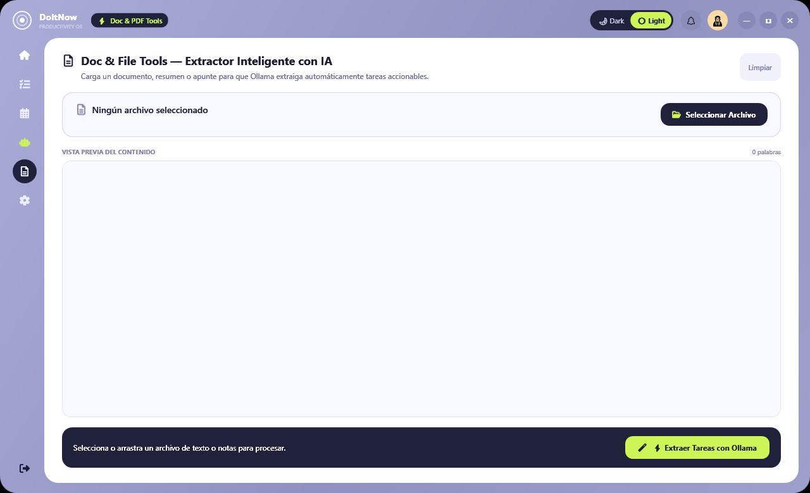

### Code notes

A dedicated code editor replaces the Windows notepad for snippets and technical notes.
It keeps line numbers, highlights syntax per language, tracks unsaved changes, and
exports real source files with the right extension. Everything is stored locally, so it
works completely offline.

| Light | Dark |
| --- | --- |
| 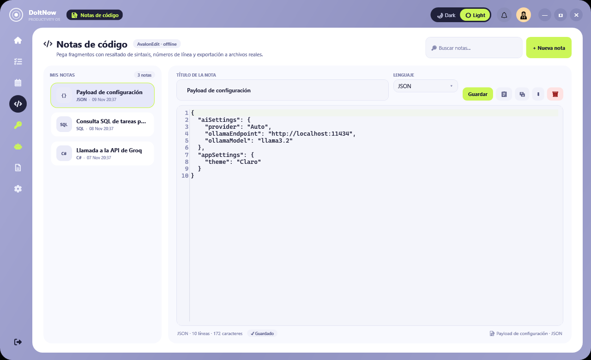 | 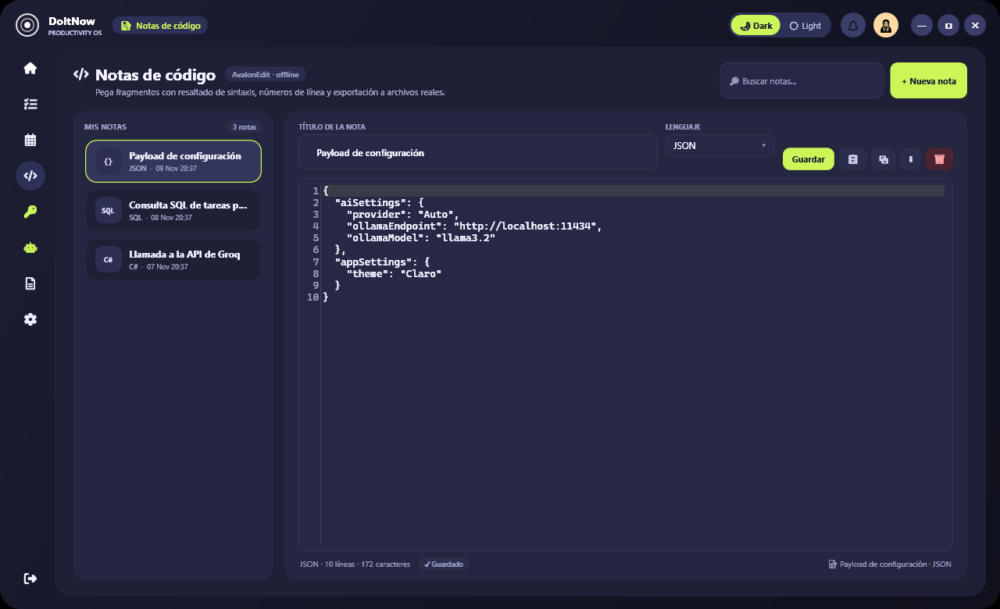 |

### Encrypted key vault

Store API keys, tokens, connection strings and passwords in an encrypted vault. Secrets
are never shown in plain text by default and are only decrypted in memory when the vault
is unlocked.

- **Transparent mode** — on first launch the vault is protected by a random key wrapped
  with Windows DPAPI (bound to the current Windows user). No password to remember.
- **Master password mode** — derive the key with PBKDF2-SHA256 and unlock every entry
  with a single password. Changing the password re-encrypts the whole vault.
- **Encrypted export/import** — move the vault between machines with a `.ditvault` file
  protected by its own password.

| Light | Dark |
| --- | --- |
| 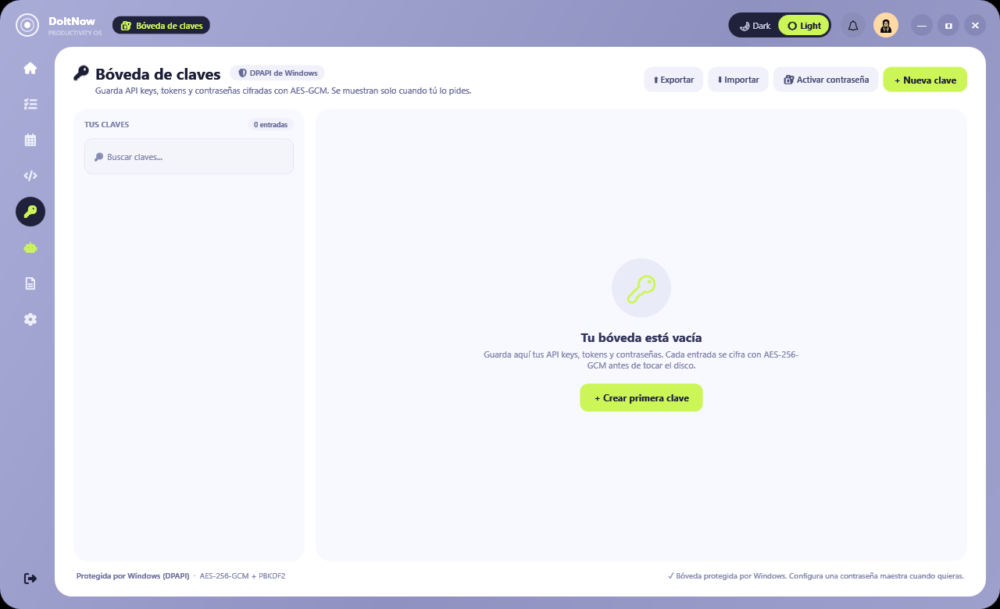 | 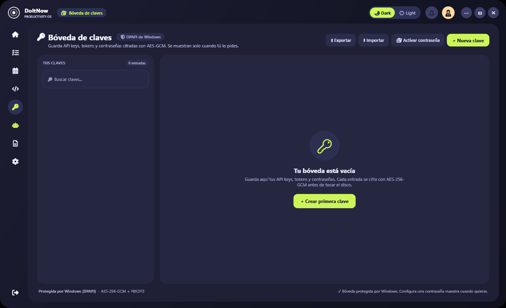 |

### Settings

Configure the AI provider, endpoints, models and API key (masked by default), open the
database folder, or load curated demo data.

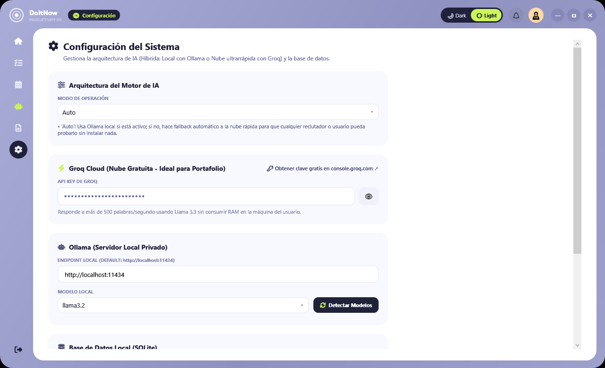

---

## Tech stack

| Layer | Technology |
| --- | --- |
| Runtime | .NET 8 (`net8.0-windows`) |
| UI | WPF / XAML |
| Presentation | MVVM with `CommunityToolkit.Mvvm` |
| Persistence | SQLite + EF Core 9 |
| Editor | AvalonEdit (syntax highlighting, line numbers) |
| Security | AES-256-GCM + PBKDF2-SHA256, Windows DPAPI |
| AI | Ollama (local) + Groq Cloud (OpenAI-compatible API) |
| Icons | FontAwesome.WPF / FontAwesome.Sharp |
| Theming | Custom semantic resource dictionaries with runtime swap |

---

## Architecture

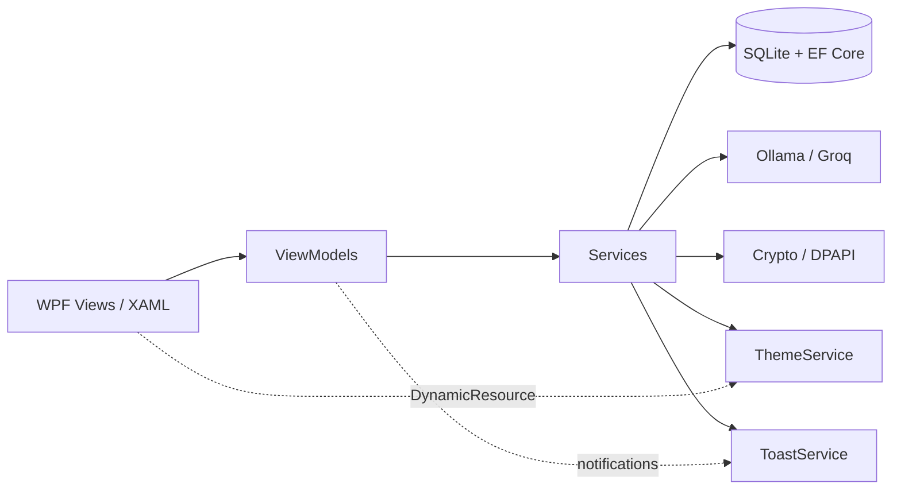

The app follows a classic MVVM split:

- **Views** (`MainWindow.xaml`, `Views/*.xaml`) contain layout and animation only.
- **ViewModels** orchestrate navigation, filtering, commands and state.
- **Services** own persistence (`TaskService`, `SettingsService`, `NoteService`),
  AI (`OllamaService`, `ChatService`), security (`CryptoService`, `VaultService`) and
  cross-cutting concerns (`ThemeService`, `ToastService`, `SyntaxHighlightingService`).
- **Models** are plain data objects; EF Core maps them in `Data/AppDbContext.cs`.

### Project structure

```text
DoItNow/
├─ DoItNow/
│  ├─ App.xaml / App.xaml.cs        # Startup, theme bootstrap, global error handling
│  ├─ MainWindow.xaml(.cs)          # Shell, navigation, toasts, window chrome
│  ├─ Views/                        # Dashboard, Tasks, Calendar, Notes, Vault, AI, DocTools, Settings
│  ├─ ViewModels/                   # Main + per-module view models
│  ├─ Models/                       # Task, SubTask, Chat, Settings, VaultEntry, CodeNote
│  ├─ Services/                     # Task, Notes, Vault, Crypto, AI, Theme, Dialog, Toast
│  ├─ Controls/                     # CodeEditor (AvalonEdit host with theme-aware colors)
│  ├─ Converters/                   # Theme-aware value converters
│  ├─ Data/                         # EF Core DbContext + initialization
│  └─ Styles/
│     ├─ Themes/LightTheme.xaml     # Semantic light brushes
│     ├─ Themes/DarkTheme.xaml      # Semantic dark brushes
│     ├─ ButtonStyle.xaml           # Buttons, combo boxes, inputs
│     └─ CalendarStyles.xaml        # Custom WPF calendar template
├─ docs/screenshots/                # Portfolio screenshots
└─ DoItNow.sln
```

---

## Getting started

### Requirements

- Windows 10 or newer
- [.NET 8 SDK](https://dotnet.microsoft.com/download/dotnet/8.0)
- Optional: [Ollama](https://ollama.com) for fully local AI
- Optional: a free [Groq API key](https://console.groq.com) for cloud fallback

### Build & run

```powershell
git clone https://github.com/your-username/DoItNow.git
cd DoItNow
dotnet restore DoItNow/DoItNow.csproj
dotnet build DoItNow/DoItNow.csproj
dotnet run --project DoItNow/DoItNow.csproj
```

Or open `DoItNow.sln` in Visual Studio 2022 and press **F5**.

> Building the solution from the CLI is also supported, but add `-m:1`
> (`dotnet build DoItNow.sln -m:1`) to avoid a known WPF temporary-assembly race on
> cold builds.

### Configuration

Copy the example configuration and add your own values:

```powershell
Copy-Item DoItNow/appsettings.example.json DoItNow/appsettings.json
```

```json
{
  "AiSettings": {
    "Provider": "Auto",
    "OllamaEndpoint": "http://localhost:11434",
    "OllamaModel": "llama3.2",
    "GroqApiKey": "YOUR_GROQ_API_KEY"
  },
  "AppSettings": {
    "Theme": "Claro"
  }
}
```

`Provider` accepts `Auto`, `Ollama` or `Groq`. In `Auto` mode the app uses Ollama when
it is reachable and falls back to Groq otherwise.

> **Security:** `appsettings.json` is git-ignored on purpose. Never commit real API
> keys. The Settings screen masks keys by default and only reveals them on demand.

### Vault security model

The key vault never writes secrets in plain text. Each entry is encrypted with
AES-256-GCM (random 96-bit nonce, 128-bit authentication tag, versioned Base64 blob)
before it reaches SQLite.

| Mode | How the encryption key is protected |
| --- | --- |
| **Windows (default)** | A random 256-bit key is wrapped with DPAPI under the current Windows user. Unlocks automatically on the same account. |
| **Master password** | Key derived with PBKDF2-SHA256 (210,000 iterations, per-vault salt). Only a verifier is stored, never the password or the key. |

Notes:

- The master password is **not recoverable**. Losing it means losing the entries.
- Changing the master password re-encrypts every entry with the new key.
- Removing the master password re-encrypts the vault again and returns to DPAPI mode.
- `.ditvault` exports are encrypted with a separate password using the same primitives,
  so backups remain safe when moved through cloud storage or email.

### Database

Tasks, conversations, code notes and encrypted vault entries are stored at:

```text
%LOCALAPPDATA%\DoItNow\doitnow.db
```

Delete that file to reset the app to a clean state. Vault secrets remain encrypted at
rest; deleting the database also deletes the wrapped vault key, so exported backups are
the only way to recover entries afterwards.

---

## Demo mode (CLI)

Useful for screenshots, demos and quick reviews:

| Flag | Description |
| --- | --- |
| `--demo` | Loads curated tasks and a sample AI conversation (idempotent). |
| `--theme=light` / `--theme=dark` | Overrides the saved theme at startup. |
| `--section=dashboard` | Opens the dashboard. |
| `--section=tasks` | Opens task management. |
| `--section=calendar` | Opens the calendar. |
| `--section=notes` | Opens code notes. |
| `--section=vault` | Opens the encrypted key vault. |
| `--section=chat` | Opens the AI assistant. |
| `--section=doctools` | Opens document tools. |
| `--section=settings` | Opens settings. |

Example:

```powershell
dotnet run --project DoItNow/DoItNow.csproj -- --demo --theme=dark --section=calendar
```

---

## Design system

The theme is not a filter or an overlay. Every view consumes semantic brushes such as
`SurfaceBrush`, `TextPrimaryBrush` or `AccentBrush` through `DynamicResource`. At
runtime, `ThemeService` swaps `LightTheme.xaml` for `DarkTheme.xaml`, and the whole UI
updates instantly.

Key tokens include:

- **Surfaces** — cards, inputs, hover states and borders
- **Text** — primary, secondary, muted and on-dark
- **Accents** — the signature lime (`#CCF658`) and lavender palette
- **Calendar** — panel, selected, today and timeline colors
- **Task cards** — priority-specific background and foreground pairs

Adding a new theme means creating one dictionary with the same keys — no view changes.

---

## Roadmap

- [x] Functional light/dark theme with persistence
- [x] Real calendar template and date-driven dashboard
- [x] Toast notifications and section transitions
- [x] Demo data and reproducible screenshot flags
- [x] Encrypted key vault with optional master password
- [x] Code notes with syntax highlighting (AvalonEdit)
- [x] Encrypted vault export/import
- [ ] Drag-and-drop task scheduling on the timeline
- [ ] Recurring tasks and reminders
- [ ] CSV / Markdown export
- [ ] Optional cloud sync backend
- [x] Build CI workflow

---

## License

Released under the [MIT License](LICENSE).
